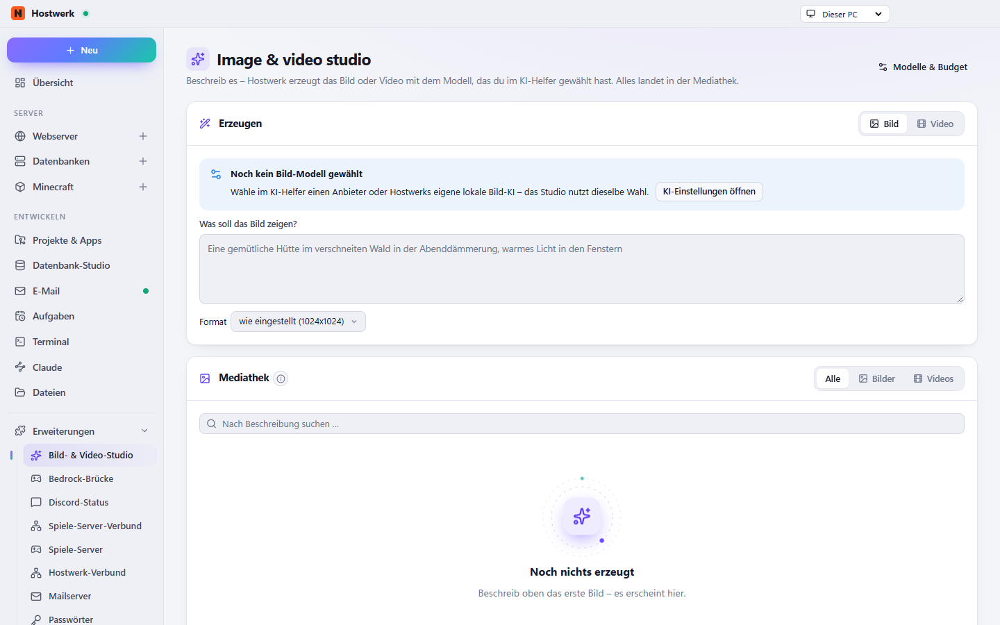

# Bild- & Video-Studio

Bilder und kurze Videos aus einer Beschreibung erzeugen – mit dem Modell, das du im KI-Helfer gewählt hast. Mit Monatsbudget und Mediathek.

[English](README.md) · Offizielle [Hostwerk](https://github.com/Passimoritz/hostwerk-public)-Erweiterung (SDK 2.7, native Erweiterung)



## Was sie kann

- **Wo:** KI → Bilder & Videos – seit 1.2.0 ohne eigenen Seitenleisten-Eintrag; die ganze Seite bleibt unter Erweiterungen → Öffnen
- Bild oder Video aus einer Beschreibung, Format bzw. Seitenverhältnis und Länge wählbar
- Nutzt den Anbieter des KI-Helfers: OpenAI, Google, Replicate, fal, Stable Diffusion WebUI oder Hostwerks eigene lokale Bild-KI
- Monatsbudget je Anbieter – vor jeder Erzeugung geprüft
- Mehrere Varianten auf einmal, letzte Beschreibungen und eigene Vorlagen; Videos auch quadratisch, Preis passend zur Länge; Abbrechen
- Mediathek: suchen, Favoriten, Ordner, mehrere auf einmal auswählen, herunterladen, löschen, ein Bild als Ausgangspunkt für Bearbeitung oder Video nutzen
- Ein Bild als Symbol eines Minecraft-Servers setzen (64×64) oder in ein Projekt speichern – unverändert, als Favicon oder als Link-Vorschau
- Alles steht auch dem KI-Chat zur Verfügung (Mediathek-ID)

## Installieren

In Hostwerk unter **Erweiterungen → Entdecken** auf „Installieren“ klicken. Wer die Funktion schon in Hostwerk 2.8 benutzt hat, bekommt die Erweiterung beim Update automatisch – mit allen Daten.

Native Erweiterungen laufen als Teil von Hostwerk (eigener Server- und Oberflächen-Teil). Darum installiert Hostwerk sie nur aus dem offiziellen Katalog (mit Prüfsumme) oder im Entwickler-Modus.

## Daten

`data/ai/media (shared with the AI helper)` – genau dort, wo Hostwerk sie schon immer abgelegt hat. Entfernen der Erweiterung löscht nichts.

## Entwickeln

```bash
node --test tests/*.test.js          # Tests
node build-native.js .               # Oberfläche bauen (sdk/build-native.js aus hostwerk-public)
node check.js . --strict             # Prüfung wie im Katalog (sdk/check.js)
```

Quelltext der Oberfläche in `ui/src`, Server-Teil in `server/`. Texte im Code sind Englisch, Deutsch steht in `locales/de.json`.

## Lizenz

MIT
