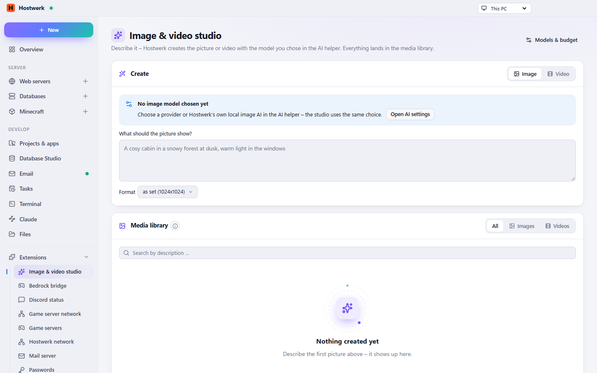

# Image & video studio

Create pictures and short videos from a description – with the model you chose in the AI helper. With monthly budget and media library.

[Deutsch](README.de.md) · An official [Hostwerk](https://github.com/Passimoritz/hostwerk-public) extension (SDK 2.7, native extension)



## What it does

- Image or video from a description, size or aspect ratio and length to choose
- Uses the provider of the AI helper: OpenAI, Google, Replicate, fal, Stable Diffusion WebUI or Hostwerk’s own local image AI
- Monthly budget per provider – checked before every creation
- Several variants at once, recent descriptions and own templates; square videos, price matching the length; cancel
- Media library: search, favourites, folders, select several at once, download, delete, use a picture as the start for an edit or a video
- Set a picture as the icon of a Minecraft server (64×64) or save it into a project – as it is, as favicon or as link preview
- Everything is also there for the AI chat (media ID)

## Install

In Hostwerk: **Extensions → Discover** and click “Install”. If you already used this feature in Hostwerk 2.8, the update installs the extension by itself – with all your data.

Native extensions run as part of Hostwerk (own server and interface part). That is why Hostwerk only installs them from the official catalogue (with checksum) or in developer mode.

## Data

`data/ai/media (shared with the AI helper)` – exactly where Hostwerk always kept it. Removing the extension deletes nothing.

## Develop

```bash
node --test tests/*.test.js          # tests
node build-native.js .               # build the interface (sdk/build-native.js from hostwerk-public)
node check.js . --strict             # same check as the catalogue (sdk/check.js)
```

Interface source in `ui/src`, server part in `server/`. Texts in the code are English, German is in `locales/de.json`.

## License

MIT
